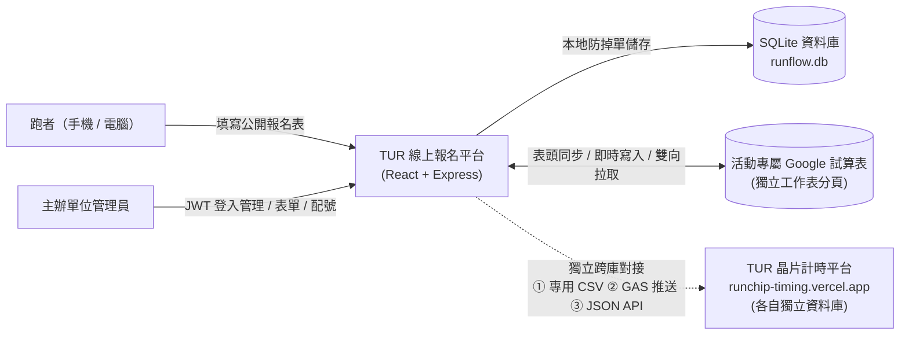

# TUR (Taiwan Ultra Runners) 路跑活動線上報名與管理平台 — 完整使用與技術說明書

> 適用版本：v2.0（TUR 官方視覺版 + 獨立資料庫晶片系統對接版）  
> 搭配計時平台：[TUR 晶片計時平台](https://runchip-timing.vercel.app/)

---

## 一、系統總覽與核心特色

本平台專為 **TUR (Taiwan Ultra Runners)** 打造，提供從「活動發起、動態報名表單、即時費用加總、Google 試算表雙向同步」到「自動配號與晶片計時系統名單對接」的一條龍流程。

| 核心面向 | 功能亮點 |
| :--- | :--- |
| **TUR 官方視覺設計** | 內嵌官方 `TUR (Taiwan Ultra Runners)` Logo、深邃夜空 36px 細網格背景、萊姆綠 / 天空藍 / 琥珀金三色光暈，並支援**戶外強光高對比模式**（黑底黃框）。 |
| **響應式設計（RWD）** | 電腦與手機皆能流暢操作；手機報名頁自動啟用底部固定金額結帳條。 |
| **動態表單設計器** | 內建 14 項 TUR 路跑標準欄位，支援拖曳排序、增刪改、11 種欄位格式、選項計價自動加總，以及組別對應**晶片代碼與配號前綴**。 |
| **Google 試算表雙向同步** | 支援 **Google Sheets API（Service Account）** 與 **GAS Webhook** 雙模式；自動建立活動專屬工作表分頁、同步表頭、即時寫入與雙向拉取。 |
| **獨立資料庫 × 晶片對接** | 與 [TUR 晶片計時系統](https://runchip-timing.vercel.app/) 各自維護獨立資料庫，互不耦合；透過「自動配號 + 專用 CSV」、「GAS 推送」或「跨系統 JSON API」無縫交換名單。 |
| **個資安全與防呆** | 台灣身分證 10 碼檢核碼驗證（相容外籍護照）、重複報名阻擋、額滿阻擋、報名確認頁與預覽畫面**身分證字號自動隱碼**（如 `A123****89`）。 |

---

## 二、系統架構與技術堆疊

### 1. 雙系統獨立資料庫架構圖



### 2. 技術堆疊

| 層級 | 技術選型 | 說明 |
| :--- | :--- | :--- |
| **前端框架** | React 18 + Vite 6 + Tailwind CSS 3 | 單頁應用（SPA），編譯後輸出至 `dist/` |
| **後端伺服器** | Node.js 24 + Express 4 | 同時支援本機常駐伺服器與 Vercel Serverless (`api/index.js`) |
| **本地資料庫** | Node.js 內建 `node:sqlite` | 免安裝額外資料庫服務，內建自動欄位遷移機制 |
| **權限驗證** | `bcryptjs` + JWT (`Bearer Token`) | 後台 API 全面驗證，密碼雜湊加密儲存 |
| **雲端試算表** | `googleapis` (Sheets/Drive v4/v3) & GAS | 支援 Service Account 與 Apps Script Webhook |

---

## 三、專案目錄結構說明

| 路徑 | 用途說明 |
| :--- | :--- |
| `api/index.js` | Vercel Serverless 後端入口 |
| `vercel.json` | Vercel 路由重寫與函數打包設定 |
| `server/index.js` | Express 主伺服器與全域錯誤處理 |
| `server/db.js` | SQLite 資料表建立、向下相容遷移、預設帳號與 TUR 範例活動初始化 |
| `server/middleware/auth.js` | JWT 簽發與後台權限檢查中介層 |
| `server/services/validation.js` | 台灣身分證檢核碼 / 外籍護照 / 電話 / Email 驗證與動態費用加總 |
| `server/services/googleSheets.js` | Google Sheets API & GAS Webhook 雙向同步、母試算表建分頁引擎 |
| `server/services/chipBridge.js` | TUR 晶片系統名單格式轉換、自動配號、隱碼、專用 CSV 與 GAS 推送引擎 |
| `server/routes/auth.js` | 管理員登入、憑證狀態查詢與密碼變更 API |
| `server/routes/adminEvents.js` | 後台活動 CRUD、橫幅上傳、試算表連線測試與一鍵建立分頁 API |
| `server/routes/adminRegistrations.js` | 報名名單管理、繳費狀態雙向同步、自動配號、CSV 匯出與推送至晶片系統 |
| `server/routes/public.js` | 前台公開活動列表、詳情查詢、防呆檢查與報名送出 API |
| `server/routes/integration.js` | 獨立跨系統串接唯讀 API（供晶片系統拉取名單） |
| `client/public/` | 官方 `tur-logo.jpg` 與 `tur-icon.png` 靜態資源 |
| `client/src/components/` | `TurLogo`、`TurHeader`、`TurFooter`、`BannerHero`、`CountdownTimer`、`FormBuilder`、`DynamicFormField`、`SyncStatusBadge` |
| `client/src/pages/` | `HomePage`、`PublicRegisterPage`、`AdminLoginPage`、`AdminDashboardPage`、`AdminEventEditorPage` |
| `google-apps-script/Code.gs` | 免 GCP 專案用的 Google Apps Script Webhook 雙向同步腳本 |
| `docs/GOOGLE_SHEETS_SETUP.md` | Google Sheets 串接專屬教學文件 |

---

## 四、系統操作手冊

### 1. 入口網址與預設測試帳號

| 項目 | 本機網址 | 雲端範例（Vercel） |
| :--- | :--- | :--- |
| **TUR 大廳首頁** | `http://localhost:3000` | `https://您的網域/` |
| **範例公開報名頁** | `http://localhost:3000/register/taipei-speed-marathon-2026` | `https://您的網域/register/taipei-speed-marathon-2026` |
| **後台管理員登入** | `http://localhost:3000/admin/login` | `https://您的網域/admin/login` |
| **健康檢查端點** | `http://localhost:3000/api/health` | `https://您的網域/api/health` |

- **預設管理員帳號**：`admin`
- **預設管理員密碼**：`runner2026`（正式上線請務必透過環境變數更改）

### 2. 前台功能說明
1. **TUR 大廳首頁**：提供「公開報名」、「晶片計時（直連 `runchip-timing.vercel.app`）」、「後台管理」三大入口卡片與開放賽事清單。
2. **戶外高對比模式**：點擊右上角「高對比」按鈕，一鍵切換為黑底白字黃框，適合戶外強光環境使用。
3. **公開報名頁面**：
   - 頂部顯示自訂橫幅、賽事計時類型（距離賽 / 繞圈限時賽）、即時報名截止倒數與名額進度條。
   - 選擇報名組別與加購項目時，即時於側邊欄（桌面）或底部條（手機）顯示應繳總金額與明細。
   - 送出後依序檢查必填、身分證檢核碼、重複報名、額滿與開放時間；成功後顯示專屬報名序號、隱碼明細與繳費資訊，支援列印 / 存 PDF。

### 3. 後台 6 大管理分頁說明

進入後台點選任一活動的 **「管理設定 / 表單 / 晶片串接」**，共提供 6 個分頁：

| 分頁名稱 | 核心功能 |
| :--- | :--- |
| **1. 基本設定與網址** | 修改活動名稱、英文名稱（雙語證書用）、公開網址代碼（Slug）、賽事模式（距離賽 / 繞圈限時賽）、活動日期、報名起訖、名額上限、活動簡介與繳費資訊。 |
| **2. 橫幅 Banner 自訂** | 即時預覽前台橫幅；可修改主標題、副標題，並支援**貼上圖片網址**、**套用內建精選背景**或上傳圖片檔案。 |
| **3. 動態表單** | 拖曳或上下鍵調整欄位排序；增刪改 11 種欄位格式；設定必填、選項金額、數字單價；在「報名組別」欄位可設定每個組別的 **晶片代碼（如 `50K`, `42K`）** 與 **配號前綴（如 `A`, `B`）**；頂部即時預覽試算表表頭。 |
| **4. Google 試算表** | 切換 3 種同步模式（API / GAS Webhook / 本地）；一鍵開新空白試算表、複製機器人 Email、一鍵自動建立該活動專屬工作表分頁與表頭、測試連線。 |
| **5. 報名名單** | 搜尋跑者、即時切換繳費狀態（會自動回寫 Google 試算表）、點擊修改單筆參賽編號（Bib）、一鍵自動配號、從試算表雙向拉取更新、補送失敗資料、匯出完整 CSV 或晶片專用 CSV。 |
| **6. 晶片系統連結** | 設定對應的 `eventId` 與晶片系統網址；提供自動配號 + 專用 CSV 下載、GAS 一鍵推送、獨立跨系統 JSON API 網址複製，以及隱碼選手名單即時預覽表。 |

---

## 五、Google 試算表雙向同步設定指南

| 模式 | 適用情境 | 關鍵設定 |
| :--- | :--- | :--- |
| **模式 A：Google Sheets API（推薦）** | 正式營運、多場活動各自獨立分頁 | 在 GCP 啟用 **Google Sheets API** 與 **Google Drive API**，建立 Service Account 取得 JSON 金鑰，將目標試算表「共用（編輯者）」給機器人 Email，並建議設定 `GOOGLE_MASTER_SHEET_ID` 作為母試算表。 |
| **模式 B：GAS Webhook** | 免開 GCP、2 分鐘快速串接 | 開啟試算表 → 擴充功能 → Apps Script → 貼上 `google-apps-script/Code.gs` → 部署為「網頁應用程式（執行身分：我、誰可以存取：所有人）」→ 將 `/exec` 網址貼回後台。 |
| **模式 C：本地展示模式** | 離線測試、暫不連雲端 | 資料存於本地 SQLite，隨時可匯出 CSV 或後續切換為雲端模式補送。 |

> 詳細步驟請參閱 [GOOGLE_SHEETS_SETUP.md](file:///e:/antigravity/活動報名/docs/GOOGLE_SHEETS_SETUP.md)。

---

## 六、TUR 晶片計時系統串接指南（獨立資料庫模式）

### 1. 標準欄位對齊表

| 本系統資料 | 晶片系統欄位 (`runchip-timing`) | 轉換邏輯 |
| :--- | :--- | :--- |
| `bib_number` | `bib`（參賽編號） | 依組別前綴自動產生（如 `A001`、`B001`）或手動指定 |
| `runner_name` | `name`（姓名） | 原樣輸出 |
| `runner_id_number` | `idNumber` / `idMasked` / `idHash` | 自動大寫；同步提供隱碼與 SHA-256 雜湊（共用 NFC 晶片主鍵） |
| `category_code` | `categoryId`（分組代碼） | 依表單組別設定（如 `50K`, `42K`, `21K`, `10K`, `5K`） |
| `gender` | `gender` | 自動標準化為 `M` / `F`（未填時由台灣身分證第 2 碼推算） |
| `birth_date` / `city` / `country` | `dob` / `city` / `country` | 直接對齊晶片系統與 DUV 超馬認證匯出格式（預設國籍 `TPE`） |

### 2. 三種串接作業流程

1. **最穩作業流程（自動配號 + 專用 CSV 匯入）**：
   - 截止報名並對帳完成（將已收款跑者改為「已繳費」）。
   - 進入後台 **「晶片系統連結」** 分頁 → 勾選「僅匯出已繳費」→ 按 **「步驟 A：依組別自動配號 (Bib)」** → 按 **「步驟 B：下載 TUR 晶片專用匯入 CSV」**。
   - 開啟 [TUR 晶片計時系統](https://runchip-timing.vercel.app/) 後台 → 選手名單 → 批次匯入剛下載的 CSV 即可完成！
2. **一鍵推送（GAS `upsertRegistrations`）**：
   - 填入晶片系統的 GAS 同步網址 → 輸入晶片系統管理員帳密 → 點擊「推送至晶片系統」即透過 HTTPS 直接傳送。
3. **跨系統 API 拉取（自動化整合用）**：
   - 晶片系統或外部腳本可呼叫：
     ```http
     GET https://您的報名網域/api/integration/events/{slug}/roster?paidOnly=true
     X-API-Key: 您設定的 INTEGRATION_API_KEY
     ```
   - 加上 `&format=csv` 則直接回傳晶片專用 CSV 檔。

---

## 七、安裝、啟動與雲端部署

### 1. 本機開發與啟動指令

```powershell
# 1. 安裝相依套件（Windows PowerShell 請用 npm.cmd）
npm.cmd install

# 2. 編譯前端正式版至 dist/
npm.cmd run build

# 3. 啟動全端伺服器（預設 http://localhost:3000）
npm.cmd start

# （選用）前後端熱重載開發模式
npm.cmd run dev
```

### 2. 完整環境變數清單（`.env` 或 Vercel Environment Variables）

| 變數名稱（Key） | 必填 | 說明 |
| :--- | :---: | :--- |
| `PORT` | 選填 | 本機伺服器埠號（預設 `3000`） |
| `JWT_SECRET` | **建議** | 後台登入 Token 加密密鑰（正式環境請設高強度隨機字串） |
| `ADMIN_USERNAME` | 選填 | 預設管理員帳號（預設 `admin`） |
| `ADMIN_PASSWORD` | **建議** | 預設管理員密碼（預設 `runner2026`，上線務必更改） |
| `GOOGLE_SERVICE_ACCOUNT_EMAIL` | 模式 A | Service Account JSON 內的 `client_email`（請勿包含雙引號） |
| `GOOGLE_PRIVATE_KEY` | 模式 A | Service Account JSON 內的 `private_key`（保留 `\n`，勿包含雙引號） |
| `GOOGLE_AUTO_SHARE_EMAIL` | 選填 | 自動建立獨立試算表時要分享編輯權限的個人 Gmail |
| `GOOGLE_MASTER_SHEET_ID` | **強烈建議** | 已共用給機器人（編輯者）的母試算表網址或 ID；設定後可一鍵建立專屬分頁，且 Vercel 重啟不掉線 |
| `INTEGRATION_API_KEY` | 跨系統 API | 呼叫 `/api/integration/*` 時帶入 `X-API-Key` 的驗證密鑰 |

### 3. 雲端部署重點提醒（GitHub + Vercel / Render）

| 項目 | 注意事項 |
| :--- | :--- |
| **GitHub 上傳檔案** | 必傳：`api/`、`client/`、`server/`、`google-apps-script/`、`docs/`、`package.json`、`package-lock.json`、`vercel.json`、`.env.example`、`.gitignore`、`README.md`。<br>不可傳：`node_modules/`、`dist/`、`.env`、`credentials/`、`data/*.db`、`uploads/*`（已由 `.gitignore` 自動排除）。 |
| **Vercel Node 版本** | 本專案使用 Node 內建 `node:sqlite`，`package.json` 已鎖定 `"engines": { "node": "24.x" }`；Vercel 專案設定請確認為 **24.x**。 |
| **資料保存機制** | Vercel Serverless 閒置重啟會清空 `/tmp` 暫存 SQLite，務必設定 `GOOGLE_MASTER_SHEET_ID` 並以 Google 試算表保存所有報名紀錄；若需長期永久保留多場後台設定與圖片上傳，建議部署於支援持久硬碟（Disk / Volume）的 **Render** 或 **Zeabur**。 |

---

## 八、RESTful API 端點速查表

| 分類 | Method & 路徑 | 權限 | 功能說明 |
| :--- | :--- | :---: | :--- |
| **系統** | `GET /api/health` | 公開 | 健康檢查與服務狀態 |
| **公開** | `GET /api/public/events` | 公開 | 取得所有啟用中的活動列表 |
| **公開** | `GET /api/public/events/:slug` | 公開 | 取得單一活動詳情、表單結構與名額狀態 |
| **公開** | `POST /api/public/events/:slug/register` | 公開 | 驗證表單、計算金額、寫入本地與 Google 試算表 |
| **驗證** | `POST /api/auth/login` | 公開 | 管理員登入取得 JWT Token |
| **驗證** | `GET /api/auth/me` | JWT | 取得管理員資訊與 Google 憑證載入狀態 |
| **活動** | `GET / POST /api/admin/events` | JWT | 取得全部活動 / 建立新活動（自動帶入預設欄位） |
| **活動** | `GET / PUT / DELETE /api/admin/events/:id` | JWT | 檢視 / 更新活動（自動同步試算表表頭）/ 刪除活動 |
| **活動** | `PATCH /api/admin/events/:id/toggle` | JWT | 啟用或暫停活動報名 |
| **活動** | `POST /api/admin/events/:id/upload-banner` | JWT | 上傳橫幅背景圖片（限 5MB 內圖片） |
| **試算表** | `POST /api/admin/events/:id/sheets/auto-create` | JWT | 一鍵建立專屬工作表分頁（或獨立試算表）並格式化表頭 |
| **試算表** | `POST /api/admin/events/:id/sheets/test` | JWT | 測試 Google Sheets API 或 GAS Webhook 連線 |
| **名單** | `GET /api/admin/events/:id/registrations` | JWT | 取得活動所有報名名單 |
| **名單** | `PATCH /api/admin/registrations/:id/payment-status` | JWT | 更新繳費狀態並雙向回寫 Google 試算表 |
| **名單** | `PATCH /api/admin/registrations/:id/bib` | JWT | 手動修改單筆參賽編號（Bib）與分組代碼 |
| **名單** | `POST /api/admin/events/:id/registrations/auto-assign-bibs` | JWT | 依組別前綴一鍵自動配號 |
| **名單** | `POST /api/admin/events/:id/registrations/pull-from-sheet` | JWT | 從 Google 試算表雙向拉取最新修改與補報列 |
| **名單** | `POST /api/admin/events/:id/registrations/retry-sync` | JWT | 一鍵補送同步異常的報名紀錄至 Google 試算表 |
| **匯出** | `GET /api/admin/events/:id/registrations/export-csv` | JWT | 匯出完整報名名單 CSV（UTF-8 BOM） |
| **晶片** | `GET /api/admin/events/:id/registrations/export-chip-csv` | JWT | 匯出 TUR 晶片計時系統專用匯入名單 CSV |
| **晶片** | `POST /api/admin/events/:id/registrations/push-to-chip` | JWT | 透過 GAS `upsertRegistrations` 推送名單至晶片系統 |
| **跨系統** | `GET /api/integration/events/:slug/roster` | API Key / JWT | 獨立跨系統標準 JSON / CSV 選手名單拉取端點 |

---

## 九、常見問題與排錯（FAQ）

| 問題現象 | 常見原因 | 解決方式 |
| :--- | :--- | :--- |
| **Vercel 上出現 404 NOT_FOUND** | GitHub 根目錄未上傳 `vercel.json` 或 `api/index.js` | 確認 GitHub 最外層包含 `vercel.json` 與 `api/index.js` 並重新部署 |
| **Vercel 改了環境變數卻沒生效** | 儲存後未重新部署，或未勾選 `Production` | 到 Vercel `Deployments` 對最新一筆按 `...` → `Redeploy` |
| **Google 驗證失敗（401 / PEM 錯誤）** | 複製金鑰時誤貼頭尾雙引號或漏字 | 移除前後雙引號與尾端逗號（新版程式亦已內建自動清理） |
| **Google 試算表 403 權限不足** | 試算表未共用給機器人，或免費帳號嘗試直接新建檔案 | 將原生 Google 試算表右上角「共用」給機器人 Email（編輯者），並改用「母試算表建分頁」模式 |
| **Google 試算表 404 找不到** | 貼到發布網址 `/d/e/...`、Excel `.xlsx` 檔或未共用 | 確認檔案為原生 Google 試算表，改貼瀏覽器網址列 `/spreadsheets/d/ID/edit` |
| **Windows PowerShell 無法執行 `npm`** | 系統 ExecutionPolicy 限制 `npm.ps1` | 指令改用 `npm.cmd`（例如 `npm.cmd install`、`npm.cmd start`） |
